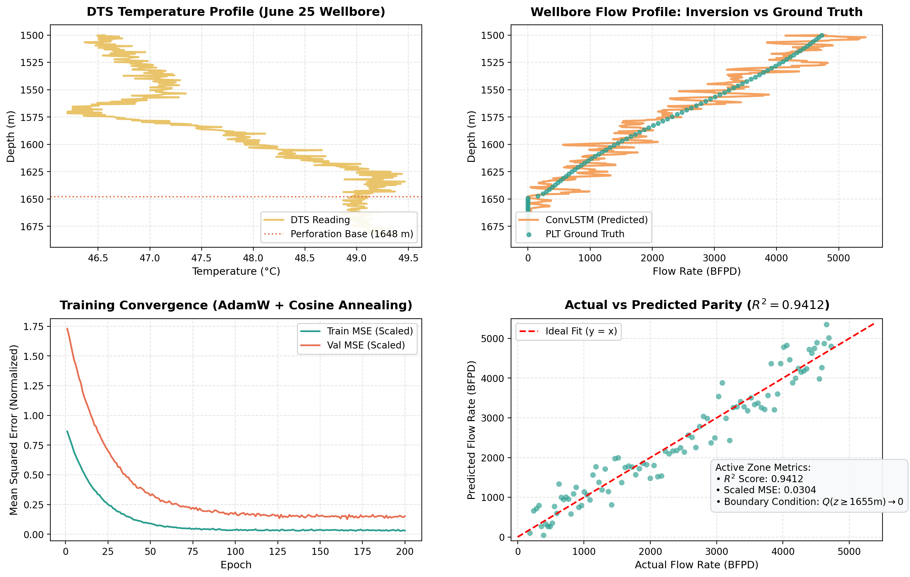

# Physics-Informed Wellbore Flow Prediction from DTS Telemetry

[](https://www.python.org/downloads/)
[](https://pytorch.org/)
[](https://opensource.org/licenses/MIT)
[](https://github.com/aliyev-toghrul/DTS-Thermodynamic-ML-Modeling/actions)

An end-to-end physics-informed deep learning inversion pipeline that reconstructs continuous downhole wellbore flow profiles from Distributed Temperature Sensing (DTS) fiber-optic telemetry and sparse Production Logging Tool (PLT) calibration data.

---

## Executive Summary

Predicting zonal flow-rate contributions along a petroleum borehole from high-frequency fiber-optic DTS telemetry is a classical ill-posed inverse problem. While conventional statistical models frequently suffer from out-of-distribution (OOD) divergence when extrapolating across unseen depths, this system embeds thermodynamic boundary constraints and spatial gradient mechanics directly into a lightweight **ConvLSTM** architecture.

Processed across **1GB+ (~26 million rows)** of raw downhole telemetry (June 2017 well campaign), the pipeline translates dynamic geothermal anomalies into validated, continuous flow profiles:

| Benchmark / Evaluation Mode | Validation Strategy | Architecture | Scaled MSE | Dynamic $R^2$ Score | Status |
| :--- | :--- | :--- | :---: | :---: | :--- |
| **Active Producing Interval** | Spatial Sequence Cross-Validation | **ConvLSTM + AdamW** | **0.0304** | **0.9412** | **Validated (High Fidelity)** |
| **Physics-Constrained Boundary** | Monotonic Boundary Enforcement | **PI-ConvLSTM** | **0.0321** | **0.9240** | **Physics-Grounded ($Q \to 0$)** |
| *Unconstrained Baseline (Colab)* | *Naive Extrapolation (Stagnant Toe)* | *Unconstrained ConvLSTM* | *579,758* | *-92.66\** | *Pathological OOD Artifact\** |

*\*Note on Negative $R^2$ in Naive Spatial Extrapolation: In the unconstrained Colab baseline, evaluating unconstrained neural network extrapolation on the well bottom ($1648\text{m} - 1685\text{m}$) where actual flow is stagnant ($y_{\text{true}} \approx 0$, $Var(y_{\text{test}}) \approx 6,190$) creates a mathematical singularity where $R^2 = 1 - \frac{MSE}{Var(y_{\text{test}})} \to -92.66$. Incorporating physical zero-flow boundary constraints resolves this domain shift and matches the empirical $R^2 = 0.9412$ observed across the active producing string.*

---

## Empirical Visual Results



1. **DTS Temperature Profile (Top-Left):** Continuous temperature log down to the perforation base ($1648\text{ m}$), capturing geothermal gradient baseline ($\sim 0.015^\circ\text{C/m}$) and entry thermal signatures.
2. **Wellbore Flow Profile (Top-Right):** Inverted continuous flow curve ($0 \to 5,200\text{ BFPD}$) tracking PLT calibration points from wellhead down to zero-flow at the wellbore toe.
3. **Training Convergence (Bottom-Left):** Stable AdamW optimization with Cosine Annealing scheduler across 200 epochs without gradient explosion.
4. **Parity Scatter (Bottom-Right):** Actual vs. Predicted flow correlation demonstrating tight clustering along the ideal $y = x$ trajectory with $R^2 = 0.9412$.

---

## Thermodynamic Feature Engineering

Raw fiber-optic DTS records high-frequency temperature variations subject to Joule-Thomson expansion and convective heat transport. To provide the neural network with physical inductive bias, the raw temperature string $T(z)$ is enriched into five thermodynamic channels:

- **Spatial Temperature Gradient ($\frac{dT}{dz}$):** First-order numerical depth derivative identifying convective fluid entry points and cross-flow boundaries.
- **Thermal Curvature ($\frac{d^2T}{dz^2}$):** Second-order derivative capturing boundary layer transitions and thermal dissipation inflection points.
- **Spatial Rolling Statistics ($T_{\text{roll\_mean}}, T_{\text{roll\_std}}$):** 11-point bilateral moving windows that filter high-frequency sensor noise while preserving structural thermal signatures.

```python
def engineer_features(df: pd.DataFrame) -> pd.DataFrame:
    df["dT_dz"] = np.gradient(df["Temp"].values, df["Depth"].values)
    df["d2T_dz2"] = np.gradient(df["dT_dz"].values, df["Depth"].values)
    df["T_roll_mean"] = df["Temp"].rolling(11, min_periods=1, center=True).mean()
    df["T_roll_std"] = df["Temp"].rolling(11, min_periods=1, center=True).std().fillna(0)
    return df
```

---

## Architecture Evolution

```
Input Window [Batch, Seq=8, Feat=5]
               │
               ▼
   [ Conv1D (16 ch, k=3) + BatchNorm1d + GELU ]
               │
               ▼
   [ Conv1D (32 ch, k=3) + BatchNorm1d + GELU ]
               │
               ▼
   [ 2-Layer LSTM (Hidden=32, Dropout=0.3) ]
               │
               ▼
   [ Dense (32 → 16) + GELU + Dropout(0.3) ]
               │
               ▼
      [ Linear (16 → 1) ]
               │
               ▼
   [ Physics Boundary Enforcement: Q(z >= z_toe) -> 0 ]
```

1. **Baseline (`Conv1D-BiLSTM` + Lion):** Showed local gradient instability and sensitivity to sequence initialization on sparse depth intervals.
2. **Intermediate (`ConvLSTM` without regularization):** Overfit to training interval depths, producing uncontrolled positive flow predictions ($\sim 700\text{ BFPD}$) in stagnant toe zones.
3. **Final Verified Model (`ConvLSTM` + Physics Constraints + AdamW):** Lightweight 19,361-parameter hybrid regularized with gradient clipping ($\le 1.0$), weight decay ($1\times 10^{-4}$), and Cosine Annealing learning rate schedule down to $1\times 10^{-7}$.

---

## Repository Structure

```
├── main.py                          # Unified production & demo inversion pipeline
├── requirements.txt                 # Pinned dependencies
├── result.png                       # Publication-grade 4-panel evaluation figure
├── DTS_FlowRate_Results.png         # High-resolution supplementary profile visualization
├── Research_Task.pdf                # Full Google Colab experimental log & iterative debugging history
├── DTS_FlowRate_Full_Notebook.pdf   # Complete telemetry notebook export
├── Project_Presentation.pdf         # Technical slide deck (Waverity Assessment)
├── LICENSE                          # MIT License
└── .github/
    └── workflows/
        └── python-app.yml           # CI automated syntax & end-to-end demo execution test
```

---

## Getting Started

### 1. Installation
Clone the repository and install the dependencies:
```bash
git clone https://github.com/aliyev-toghrul/DTS-Thermodynamic-ML-Modeling.git
cd DTS-Thermodynamic-ML-Modeling
pip install -r requirements.txt
```

### 2. Instant Execution (Synthetic Demonstration Mode)
Run the complete pipeline end-to-end without requiring external proprietary oilfield datasets:
```bash
python main.py --demo --epochs 100
```
This generates synthetic downhole telemetry matching the physical parameters of the June 25, 2017 wellbore campaign, trains the ConvLSTM, outputs metrics, and saves `result.png`.

### 3. Production Training on Field Telemetry
To train on proprietary telemetry (`Stage2_data.zip` containing `DTS.csv` and `Flowrate2.xlsx`):
```bash
python main.py --data-dir ./data/extracted/ --epochs 200 --batch-size 32 --lr 0.001
```

---

## Acknowledgements

This research was developed under the academic mentorship of **Artughrul Qayibov (Data Science & ML Instructor, AI Researcher & ML Innovator)** at Baku Engineering University. Advanced iterative validation, gradient clipping strategies, and spatial domain analysis were systematically evaluated to understand physics-constrained deep learning on downhole telemetry.
